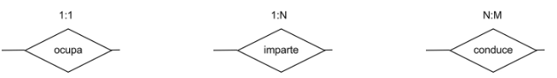

# Cardinalidades de las Relaciones

La cardinalidad indica el número máximo de instancias de cada entidad que pueden intervenir en una instancia de la relación. Aparece en el
\
diagrama como una etiqueta 1:1, 1:N o N:M.

En otras palabras, intenta definir el número máximo de relaciones entre un "paquete de datos" de una entidad con los otros "paquetes de
\
datos" en la otra entidad. Por ejemplo, entre las entidades Cliente y Pedido, un cliente (su paquete de datos nombre, dni, etc) se puede
\
relacionar de forma máxima con uno o más pedidos (siendo cada paquete de datos lo relativo a un solo pedido, como dirección, coste, fecha
\
de entrega…) ya que un mismo cliente podrá hacer muchos pedidos y por el contrario un pedido SOLO podrá ser demandado por un cliente.
\
Será por tanto una Cardinalidad del caso 2, de uno a muchos o también definido como 1:N.

<figure><figcaption></figcaption></figure>

#### Uno a Uno (1:1)

Un puesto de trabajo puede estar ocupado
\
por un solo empleado, y un empleado puede
\
ocupar un único puesto simultáneamente.
\
Cada entidad se relaciona con como máximo
\
una instancia de la otra entidad.

#### Uno a Muchos (1:N)

Una asignatura es impartida por un único
\
profesor, pero cada profesor puede impartir
\
muchas asignaturas. Una instancia de una
\
entidad se relaciona con múltiples instancias
\
de la otra, pero no al revés.

#### Muchos a Muchos (N:M)

Cada autobús puede ser conducido por
\
distintos conductores en diferentes turnos, y
\
cada conductor puede conducir varios
\
autobuses. Ambas entidades se relacionan
\
con múltiples instancias de la otra entidad.
