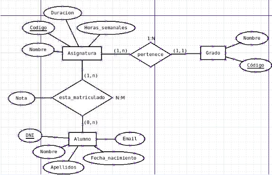

# Cardinalidades del Diagrama

Una vez definidas las entidades, relaciones y atributos, se añaden las cardinalidades al diagrama.

#### Relación: esta\_matriculado (N:M)

Un alumno puede estar matriculado en 1 o varias asignaturas →
\
cardinalidad (1,n) en el lado de Asignatura. Una asignatura puede
\
tener ninguno o varios alumnos matriculados → cardinalidad (0,n)
\
en el lado de Alumno. Cardinalidad de la relación: N:M.

#### Relación: pertenece (1:N)

Una asignatura pertenece a uno y solo un grado → cardinalidad
\
(1,1) en el lado de Grado. Un grado se compone de mínimo 1 y
\
máximo varias asignaturas → cardinalidad (1,n) en el lado de
\
Asignatura. Cardinalidad de la relación: 1:N.

<figure><figcaption></figcaption></figure>

