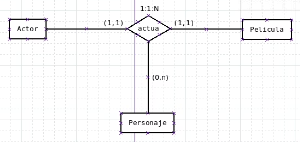

# Grado de una Relación

#### El número de&#xD; entidades que&#xD; participan en una&#xD; relación o Grado de&#xD; una relación

El grado de una relación determina su complejidad. Las relaciones de alto
\
grado (n-arias) deben reducirse siempre que sea posible, sustituyendo la
\
relación compleja por una nueva entidad con relaciones binarias hacia
\
cada una de las entidades originales, haciendo el modelo más intuitivo y
\
manejable, lo que conoceremos como Entidad Intermedia.

<figure><figcaption></figcaption></figure>

Reflexiva o Unitaria: una sola entidad participa en la
&#x20;relación consigo misma (p. ej. EMPLEADO —
&#x20;casado).

Binaria: participan dos entidades; es el tipo más
&#x20;habitual en el modelo E/R.

Ternaria / N-aria: participan tres o más entidades;
&#x20;conviene reducir su grado cuando sea posible.
